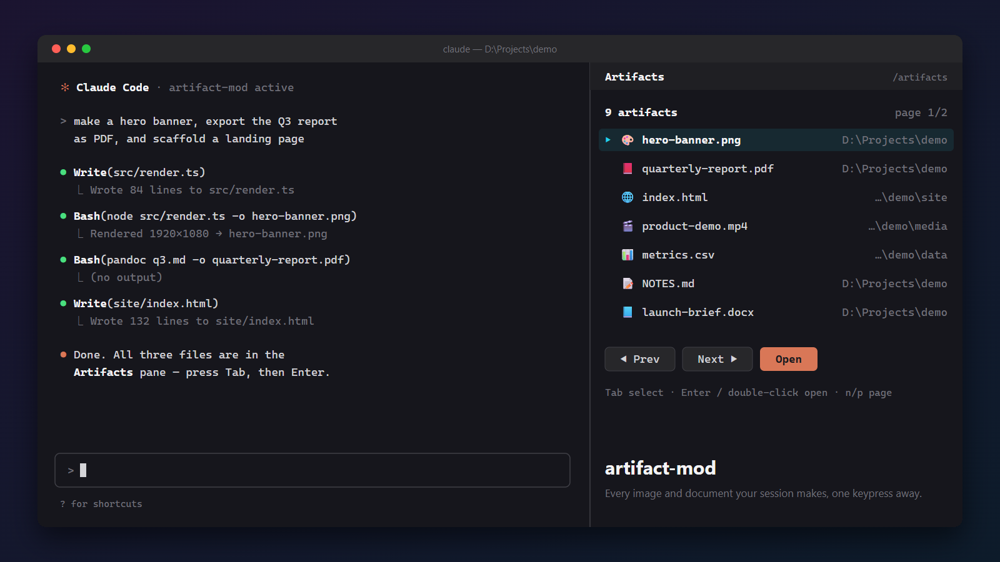

# Local Artifacts

A Claude Code mod that lists the media files and documents created during a session, in a side pane, and opens them with your system's default app.

> **Claude Code only.** Runs in the Claude Code CLI (v2.1.287+), the Desktop app's Code tab (v2.1.286+) and the VS Code extension (v2.1.299+ for panes). It does nothing in claude.ai chat or Cowork.



The pane lists the files a session made (images, PDFs, office documents, spreadsheets, Markdown, HTML, audio, video), each with an icon for its file type. Opening an item launches it in your system's default app.

## Install

In Claude Code, add the marketplace, then install the plugin from it:

```
/plugin marketplace add netgfx/claude-artifact-mod
/plugin install powermods-artifacts@claude-artifact-mod
```

Or do both in one step (Claude Code v2.1.275 or later):

```
/plugin install powermods-artifacts --marketplace netgfx/claude-artifact-mod
```

From a terminal: `claude plugin marketplace add netgfx/claude-artifact-mod`, then `claude plugin install powermods-artifacts@claude-artifact-mod`.

**Upgrading from `artifact-mod`.** The plugin was renamed from `artifact-mod` to `powermods-artifacts` in 0.4.0. The marketplace's `renames` entry moves existing installs to the new name. If Claude Code then reports that the plugin isn't cached, run `/plugin install powermods-artifacts@claude-artifact-mod` once. Claude Code keeps each plugin's store under its name, so the file lists saved by `artifact-mod` aren't carried over: a session resumed after the upgrade starts with an empty pane, and new files are listed as usual.

## Features

- **Automatic tracking.** After any tool call, files it created are added: paths named in the tool's input, path-like tokens in shell commands (`> out.txt`, `-o report.pdf`, `"$PWD/out.png"`), and new files at the top level of the working directory or in the folders of any paths the tool named. A read-only tool counts only for the file it was told to save (a browser screenshot's `filename`). Files that already existed and were only edited are left out, as are `.git`, `node_modules` and Claude Code's `.output` task logs.
- **Paths only.** The mod keeps each artifact's local path and when it was first seen, nothing else. The list survives resume, and is deleted 30 days after the session last opened or changed it.
- **Stays in sync with disk.** Files deleted from disk disappear from the pane within a few seconds.
- **Media and documents only.** 🎨 images, 📕 PDF, 📘 Word/ODT/RTF, 📙 slides, 📊 spreadsheets, 📝 text/Markdown, 🌐 HTML, 🎵 audio, 🎬 video. Code, config, archives and binaries are not listed.
- **Pagination.** Page size fits the pane's height. ◀ Prev / Next ▶ (`p` / `n`).
- **Open with the default app.** `explorer.exe` on Windows, `open` on macOS, `xdg-open` on Linux.

## Usage

| Action | Result |
| --- | --- |
| `/local-artifacts` | Open the pane and give it the keyboard |
| Tab | Select an item |
| Enter, or `o` | Open the selected item |
| Double-click | Open an item |
| `n` / `p` | Next / previous page |

The pane opens by itself when a session starts. Claude Code places a pane a mod opens by itself only once the terminal is wide enough.

## Data, network and permissions

Everything stays on your machine. See [PRIVACY.md](PRIVACY.md) for the privacy statement.

**Tool calls it watches**

- A `tool.call` hook sees every tool call. It reads the call's input only to spot the files the tool writes: path-like fields (`file_path`, `filename`, `output` and similar) and path-like words in Bash and PowerShell commands.
- It never changes, approves, denies or blocks a call: it passes each one on unchanged, and if the hook fails, the call goes on as if the mod weren't there.

**Files it reads and writes**

- Reads file metadata only, never contents: before a tool runs it checks which named files already exist and lists the working folder and the folders of the named paths (up to 8 folders, top level only); after the tool runs it checks the size, type and modification time of those files. Every 4 seconds it checks that listed files still exist.
- Writes no files.

**What it keeps, and for how long**

- The list of files for each session goes into the plugin's `$.store` under `session:<session id>`: each file's path, when it was first seen, and when the list was last saved. Claude Code keeps one `$.store` per plugin, shared by every session on the machine that runs the mod.
- When a session starts, the mod deletes the lists of other sessions that haven't been opened or changed for **30 days**. Resuming a session keeps its list for another 30 days.
- To delete every saved list yourself, delete the file under `~/.claude/plugins/store/` whose name starts with `powermods-artifacts_` while no Claude Code session is running.
- The pane's state (the list, the page, the selected row) is also held in `$.state` for the session.

**Programs it starts**

Only when you open an item:

- Windows: `explorer.exe <file>`.
- macOS: `uname -s` once, to tell macOS from Linux, then `open <file>`.
- Linux: `uname -s` once, then `xdg-open <file>`.

Each runs through `$.process.run` with an argument list, never through a shell. The file then opens in whatever app your system uses for that type.

**What it doesn't do**

- No network calls: `network.hosts` in `plugin.json` is empty.
- Sends nothing to a model, submits no prompts and adds nothing to the system prompt.
- Sets no environment variables and reads no settings. It reads the `OS` environment variable, the session's id and the working folder.

**Hooks it registers:** `session.start` (registers `/local-artifacts`, restores this session's list, deletes lists older than 30 days, opens the pane), `command.run` for `/local-artifacts`, `tool.call` (above), `ui.focus` and `ui.render` for its own pane.

## Development

```
claude plugin validate .
claude plugin test .
claude --plugin-dir .
```

`claude plugin test` runs `tests/artifact-mod.test.ts`. Each tracking test runs twice, with a Windows session (`C:/work`) and a POSIX one (`/work`), and the suite passes on Windows and Linux. CI runs it on both, together with `claude plugin validate --profile directory --strict`.

## License

[MIT](LICENSE)
